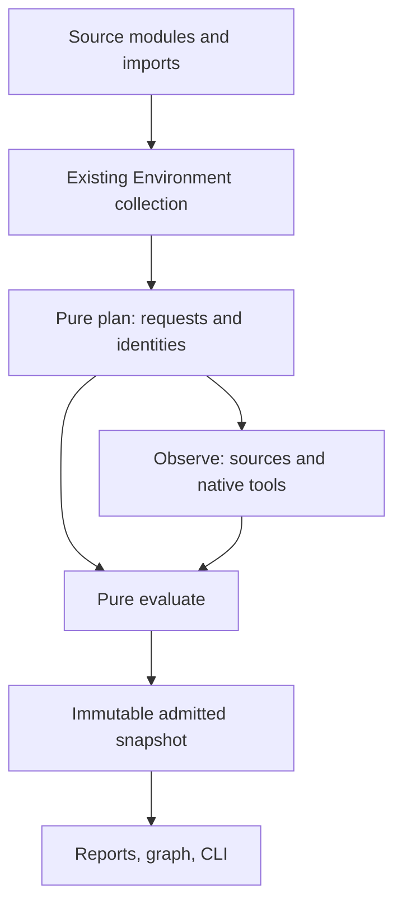

# Reviewing the realization architecture

Working review protocol, 2026-11-07. Initial production reference: `169d43a4`.
This document defines questions, cases and measures for a joint architectural
review. It is not architectural acceptance, a performance certificate, or an
instruction to implement every future provider.

The [model contract](REALIZATION_MODEL.md) remains the semantic source of truth;
the [implementation guide](REALIZATIONS_AND_TRANSLATIONS.md) describes the current
API and limitations. This protocol supplies traceability and acceptance measures,
not a second specification. The formal proof port is a separate PR.

## Review method

For each case, work in this order:

1. State the author's intended question and show the smallest actual source input.
2. Write expected observations and results independently of the implementation,
   including one relevant edit, one irrelevant edit and one unavailable input.
3. Trace the input through collection, observation, binding, evaluation and output.
   Identify which facts are authored, observed or derived at every boundary.
4. Challenge both false success and unnecessary failure/invalidation. Include a
   positive case: rejecting everything is not a correct implementation.
5. Identify the work and retained data needed for this case. Measure only the
   uncertain costs that could change an architectural decision.
6. Record keep/change/defer, its reason, supporting evidence and untested limits.
   Prefer a field or boundary check when that suffices; an extra subsystem must
   earn its place through a supported use case or measured need.

Do not collapse the review into a weighted score. Incorrect completion is a hard
failure; speed cannot compensate for it. Conversely, soundness alone does not
establish usability or scalability. A deliberate conservative limitation must be
visible, documented and assessed for its cost to authors.

## Use cases and acceptance obligations

These IDs index the fuller examples in the model contract. “Current” means a
supported path to review, not blanket acceptance of every variant. “Boundary”
means the first model must represent the intent or diagnose lack of support;
it does not require a new provider in this PR.

| ID | Author's question / operation | Required observable distinction | Review scope and starting evidence |
| --- | --- | --- | --- |
| U1 | Attach one Lean theorem and prose statement; inspect its status. | Separate native statement/body results from unassessed prose and correspondence. A definition of a proposition differs from a proof-valued definition. | Current. `BlueprintAssessmentSnapshot`, `BlueprintRealizationCapture`, `BlueprintRealizationAdapter`. |
| U2 | Review prose-to-Lean correspondence; edit the proof, statement or imported definition. | Proof-only edits preserve the statement review; admissions can break prerequisite completion; relevant statement/interpretation changes stale the review. Explicitly assessed proof content behaves differently. | Current. `test-assessment-snapshot.py`, `test-realization-semantic-binding.py`, `BlueprintTranslations`. |
| U3 | Require Alice's review; reject, replace or withdraw a judgment. | Only the explicitly selected suitable judgment counts. No historical fallback, reviewer substitution or evidence-induced binding change. | Current, symbolic reviewer identity. `BlueprintAssessmentSnapshot`, `BlueprintTranslations`; review inputs are mocked in tests. |
| U4 | Develop two proofs of the same statement. | Keep each proof/relation result and its native assumptions; an unfinished alternative cannot block an unrelated completed development or repair code using an admitted proof. Future suitable-proof selection needs an assumption policy. | Boundary for coexisting native Lean proofs: independent target matching does not yet qualify as `proves` support. Current per-relation controls cover an informal alternative with required mathematical review. Aggregate any/all requests and proof independence remain deferred. |
| U5 | Declare uses, including forward/imported references, custom native bases and cycles. | Preserve authored intent versus observed native dependencies; select exact targets independently of completion. A label's ordinary Lean declarations are one development and a use requires all of them; a statement-axis use requires theorem statements, a proof-axis use theorem proofs, and both require data-definition implementations and proposition-definition statements. Independent alternatives are not silently conjoined. Cyclic validation cannot bootstrap completion. | Current. `BlueprintAssessmentSnapshot`, `BlueprintRealizationCapture`, `BlueprintRealizationDependencies`. |
| U6 | Add an extra mathematical or exposition claim to a proof relation. | Exact native support remains visible; an unassessed, pending or rejected additional claim prevents full relation completion. | Current. Regression repaired in `169d43a4`; pure and actual capture tests. |
| U7 | Relate a paper/PDF, a Verso account and Lean formalization. | Three distinct selections and assessments. A transcription is not the original; missing/ambiguous original content cannot silently fall back. No automatic composition of correspondences. | Boundary. Supported byte/native selections are current; exact PDF-region resolution and OCR checking are not claimed. |
| U8 | Translate Rocq to Lean using a close port, representation change, reconstruction or split/merge strategy. | Mapping, assumptions and joint endpoints determine the claim; tags only classify. Native target success is insufficient for foreign correspondence. | Boundary with local Rocq source fixture. `BlueprintRealizationThreeWay`; foreign resolution/checking remain unsupported. |
| U9 | Attach Rust examples or an implementation and prove properties of its Lean model. | Attachment, test results, Rust/model correspondence and mathematical proof remain separate. Definitions need no invented theorem-proof task. | Boundary; no new Rust validation provider or mapping language is required here. |
| U10 | Navigate key theorems, show their steps and query unfinished work. | Presentation significance/grouping does not alter assessment; results identify their exact subject and requested contract. Missing sources, rejection and malformed input have different explanations. | Current labeled reports/native summary; richer graph, hierarchy policy and aggregate requests are deferred. |

For each case, retain a compact review record:

```
ID / exact implementation and fixture revision
Actor and question; source input; explicitly requested contract
Expected local result, prerequisite result and explanation
Relevant edit / irrelevant edit / missing or ambiguous input
Authored facts -> provider facts -> derived result
Commands, actual output, limits; tested / inspected / not exercised
Decision, alternative rejected, next bounded check
```

Cross-cutting controls include conflicting imported identities versus unavailable
sources, complete-batch rejection versus per-assessment failure, and state cleanup
on ordinary errors and resource interruption. For U1/U8, distinguish native
own-type support from an independent target: matching must preserve its full
proposition, universe generality and hypotheses or explicitly report unsupported.
The current independent-target API's concrete-universe restriction is a limitation,
not evidence that arbitrary polymorphic targets work.

Do not turn the number of rows into a feature checklist. U7–U9 can pass a boundary
review by representing a claim accurately and reporting unsupported validation.
They cannot pass by inventing observations. The existing design acceptance table
remains the detailed mutation catalog; avoid copying it into multiple test plans.

## Backend map, anchored in U1–U3

### Agreed reference case: `toggle_twice`

Accepted by the maintainer on 2026-11-08 as the first joint-review case (U1–U3).
An author supplies a globally labeled node `toggle_twice`, a prose statement
(toggling a flag twice returns the original flag), and a Lean declaration
containing the formal statement and proof. The author explicitly claims that
the prose and Lean statements correspond. Attachment alone makes no such claim.

For this case, the requested correspondence contract requires Alice's review of
the selected statements/interpretation and the selected native proof's completion.
Prose proofreading is optional. Reviewing proof method or explanation would be a
separate explicitly selected assessment. The three reader questions are:

1. Is the current native proof complete?
2. Does Alice's selected judgment approve the current correspondence?
3. Are all conditions of this particular correspondence contract satisfied?

| Situation | Native proof | Alice's judgment | Correspondence contract |
| --- | --- | --- | --- |
| Valid proof, no review | Complete | Awaiting review | Unfinished |
| Alice approves the current statements | Complete | Current approval | Complete |
| Proof rewritten, selected statement meaning unchanged | Rechecked | Approval stays current | Complete if the new proof passes |
| Proof replaced with `sorry` | Incomplete | Approval stays current | Unfinished |
| Selected statement or mapping changes | Independently assessed | Previous approval is stale | Unfinished |
| Alice withdraws approval | Independently assessed | No current approval | Unfinished |
| Another unfinished proof is added | Each proof assessed separately | Unchanged if assessed content is unchanged | Existing contract retains its exact selected prerequisites |

This specifies expected behavior independently of backend representation. It does
not claim implementation of the independent native alternative route in U4.
Success includes natural authoring and explanations of each unfinished result;
the record count, public convenience API and cost remain architectural review
questions. The small implemented fixture uses a trivial proposition; this
mathematical narrative is the agreed use-case specification, not a new executed
Flag test.

### Current backend trace

An ordinary `@[blueprint "label"] theorem ...` supplies an accepted source
association. Current capture produces separate native statement/proof realizations
and their checks. Prose has its own selection. Named `proves` and correspondence
relations, required reviewers and current judgment selections are explicitly
authored today. This is the authoring baseline to inspect, not a commitment that
the current amount of record-writing is the ideal public API.



| Boundary | Inputs and authority | Current implementation / review question |
| --- | --- | --- |
| Authoring and imports | Accepted ordinary source records plus staged authored envelopes. Persist source facts and recorded human judgments, never native success. | `Environment`, `Authoring`, producers. Ordinary node admission is not final assessment admission. Are conflicts/forward references handled at the correct boundary? |
| Plan | Immutable collected input to typed request inventories and an ordered recipe. Recipe positions are private to the plan. | `Capture.plan`. Are source identity, ownership and context retained without deriving meaning from display names? |
| Observe | Plan plus current source/checking environment; returns observations or diagnostics. Each answer is identified by the request it answers, and a request asked several times is answered once. | `Capture.observe`, `NativeSource`, `Validation.Lean`, `Validation.Semantic`. Are physical reads and shared semantic work reused only within a compatible capture? |
| Evaluate and admit | Plan and supplied observations; no new file/tool reads. | `Capture.evaluate` replays the collection recipe against observations, looking each answer up by its request. Missing, duplicate and mismatched answers are rejected; answers to requests the plan does not make are ignored. Finalization wires uses and checks the structural batch once. It computes bindings from the selected content, validates existing and freshly bound evidence together, then evaluates the whole registry. Only the final snapshot is published. Measure preparation, replay and evaluation separately. |
| Query and presentation | Read-only admitted snapshot and derived indexes/results. | `Registry`, `Report`, `Snapshot.assessmentFor`, CLI/graph consumers. Can every result be explained by the exact contract, without a hidden universal node-completion policy? |

These are distinct representations with one direction of authority, not five
independently mutable stores. Inspect which invariants each transformation
establishes; do not assume the word “snapshot” establishes them automatically.

In particular, keep three dependency structures distinct:

- **Semantic dependencies** determine selected content's meaning and freshness.
- **Validation prerequisites** gate completion without implicitly selecting bodies.
- **Authored/display relationships** describe organization or intent and have only
  their explicitly declared validation consequences.

For lifetime management, review scopes rather than introducing a generic RAII
framework: environment/metavariable/info state restored on every observation exit;
capture-owned caches tied to an immutable environment; failed capture cannot
publish a partial assessment. Persistent extension records and serialized reports
have different lifetimes and must never restore old native success as current.

## Goals and measures

The semantic obligations above are agreed requirements. Performance and ergonomic
targets below are proposed review measures; numeric product budgets still need
agreement using representative workflows.

| Goal | What to measure or inspect | Acceptance basis |
| --- | --- | --- |
| Soundness and useful success | Exact expected result/explanation for positive and negative mutations; ownership, binding, selection and availability controls. | No false completion, dropped obligation or unrelated-evidence borrowing in supported cases. Explicit provider/hash trust boundaries. Formal proof completion is separate. |
| Expressivity | Can U1–U10 be represented using ordinary records and explicit contracts without special-case encodings or fabricated facts? | Supported cases work; deferred providers produce accurate unsupported outcomes. New relation tags do not secretly become policy. |
| Authoring ergonomics | For adding a theorem, correspondence, review or alternative: count manual records/keys, repeated facts, required files/commands and whether authors need private APIs. Inspect the actual resulting source diff. | Avoid multiple independently authored copies of one fact; make mistakes diagnosable. Counts expose friction, not a universal maximum or a reason to hide meaningful choices. |
| Latency | Separate owning-module build/setup, plan, observe, evaluate, report construction and public edit-to-query time. Record wall time and Lean heartbeat failure separately. | A successful report and semantic assertions are the endpoint. A timeout/heartbeat exception is a failed workload, not a timing sample of completed capture. |
| Memory and scalability | Whole-process-tree peak, retained input/snapshot/report size, native semantic closure size, and cost as each input axis grows. | Complete bounded workloads without resource exceptions; explain growth and shared work. Small native fixtures alone cannot certify FIR-scale behavior. |
| Freshness precision | Which saved judgments survive proof-only, statement, computational dependency, helper, mapping, prose and irrelevant edits? | Relevant changes invalidate; required independent edits preserve. Document conservative byte-selection invalidation rather than claim universal semantic precision. |
| Explanation and agent queries | From a result, recover the subject, selected requirements, current judgment and missing/rejected/stale/prerequisite reason. Measure representative query/report cost and output size. | No success inferred from provider outcome alone; no opaque green node masking unfinished sibling work. Queries identify the captured build rather than claim to recheck edited source. |
| Simplicity and maintainability | Inventory authoritative fields versus derived indexes; trace where each policy is implemented. Inspect duplicated selectors, repeated normalization and interfaces needed by tests/proofs. | A policy has one authoritative implementation or a documented distinct boundary. Keep an abstraction only if it reduces duplication or enables a named case. Fewer files/lines alone is not evidence. |

## Performance experiment design

Use three workload classes; do not confuse their claims:

1. **Micro/semantic controls:** the existing S/P/T example and small synthetic
   graphs. Detect correctness regressions and isolate a mechanism.
2. **Focused scaling controls:** vary one axis at a time: records, requirements,
   evidence per requirement, chain/diamond/fan-out shape, selected text bytes,
   or unique versus shared native semantic dependencies. Hold others fixed.
3. **Representative workflow:** a pinned real Blueprint, initially the existing
   five-concept FIR probe. Separate native setup from capture. The prior larger
   FIR failure remains unresolved performance evidence, not a reason to repeat it.

Report actual sizes: node count is insufficient. Include source bytes, selected
declarations, semantic vertices/edges, requirement/prerequisite edges, review
records and serialized output bytes where the existing instrumentation permits.
Count collection/admission work as well as hashing; Merkle structure alone does
not imply the whole capture or report is efficient.

Use a small size ladder, starting below known resource limits; stop at the first
failure. For fixed input shape, report time/byte growth ratios and investigate
unexpected superlinear growth. Treat approximate linearity modulo sorting/hashing
as a hypothesis for the pure indexed portions, not a proved global complexity
bound or a promise about Lean elaboration.

For each experiment pin code, workload bytes, toolchain/dependencies, command,
options, backend and artifact-cache policy. Measure setup separately and verify
actual expected outputs. Distinguish warmed captures from cold builds and cached
Lake work from executed work. Use the original public workflow for end-to-end
claims; source edits/builds/imports must remain ordinary, without mtime tricks or
shared-cache deletion.

For a claimed speedup, use comparable inputs, sequential order-balanced runs and
raw measurements sufficient to distinguish the effect from noise. Keep diagnostics
out of headline timings. Attribute a runtime hotspot with backend-appropriate
profiles before optimizing it; counters and another project's hotspot are not a
substitute. Preserve timeouts, failures and excluded runs with reasons.

Existing safety ceiling: verified **8 GiB whole-tree memory, zero swap**, explicit
wall timeout and retained logs/exit status. This is an operational ceiling, not a
claim that 8 GiB is an acceptable product target. For a future repeat of the FIR
probe, retain its 180 s capture-run boundary and 200,000-heartbeat limit unless a
separate decision changes the experiment; setup must not consume the capture
measurement. Verify actual child limits before running. Do not start full FIR
generation or increase limits as part of this review protocol.

Before each measured workload, record the expected result, deadline, memory limit,
sampling plan and stopping rule. Before claiming readiness, agree the actual
interactive and build-time product budgets; do not invent a median or p95 target
from a single tiny test. This document launches no benchmark campaign.

## Joint review order and decisions

Start with U1–U3 and their actual authoring records. Trace one snapshot all the way
through the backend before broadening the vocabulary. Then examine U4–U6 for
ownership/prerequisite pressure, and U7–U10 for representational limits.

Bring concrete decisions to the maintainer:

- Which native associations/contracts should ordinary authoring derive, and which
  mathematical claims must remain explicit? Compare actual source diffs first.
- Does the current `Translation` plus named `Claim` representation serve required
  use cases, or impose avoidable authoring/coherence work? Do not merge or expand
  these records without testing the proposed simplification against those cases.
- Do the legacy opt-in dependency/report APIs still have a distinct supported
  purpose alongside canonical capture? Prefer retirement over compatibility-only
  duplication if they do not.
- Which everyday workload sets the latency and memory target? What invalidation
  precision is necessary, and where is documented conservative behavior acceptable?

Maintain a short decision ledger here as decisions are made: use-case IDs,
proposal, accepted/deferred outcome, evidence and reason. Link the semantic
contract or implementation change instead of duplicating it. A counterexample
normally earns a rule and regression, not a new persisted entity.

Initial ledger:

| Decision | Basis | Status |
| --- | --- | --- |
| Review architecture through explicit cases, costs and authoring examples. | Maintainer request, 2026-11-07. | Agreed methodology; case priorities and product budgets reviewed together. |
| Start with the `toggle_twice` authoring/correspondence scenario above. | Maintainer confirmation, 2026-11-08. | Expected behavior agreed; backend and ergonomic review next. |
| Keep formal proof completion in a second PR. | Production behavior, regression evidence and formal verification have distinct review scopes. | Agreed; proof checkpoint preserved, port paused. |
| Native support cannot discharge unassessed attached claims. | Actual capture counterexample and positive/negative repair controls. | Implemented and focused-tested at `169d43a4`. |
| Distinguish proof-body replacement from renamed selection and coexisting native proofs. | Claude's 2026-11-07 addendum, checked against the current minimum-support gate. | Renamed-selection control added as a target; native U4 relabeled Boundary. No independent-target support implementation activated. |
