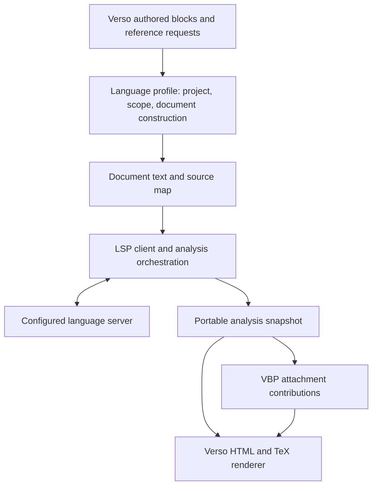

# Reusable Verso LSP adapter: design round one

Status: proposal, 2026-10-22. A first experimental protocol/mapping core now
exists; see the [spike results](VERSO_LSP_SPIKE.md). No supported public API is
established by this document.

The intended product supports **both checked code blocks and named external
references**, with a reusable Verso adapter deployed first in Verso Blueprint.
The adapter consumes language servers to enrich authored documents. Its core
must work without Blueprint labels, graph state, or a particular Verso genre.

## Evidence and scope of review

- [PR #63](https://github.com/leanprover/verso-blueprint/pull/63), head
  `965ae507b478fe926413dea8b9d4303f7dd88c0c`, targets `v4.32.0` and introduces
  only the persisted foreign-reference model and plumbing. It has no LSP
  transport, author-facing lookup, or renderer. GitHub showed no review or
  discussion comments during this review.
- Current default development is `v4.35.0`, reviewed at
  `4932a7e3b283dd763f546e949ece88c3aed58a5a`. The current contribution and
  assembly model differs substantially from the PR's registration model.
- The older local `foreign-lsp-references` branch, head `635b8d2a`, contains a
  fuller experiment, including `ForeignLsp.lean` and Rust lookup panels. It is
  separate evidence, not code included in #63.
- Pinned Verso: `304b8561790c50222551c937ce02928df0d5b445`; pinned SubVerso:
  `892d6dc520270b5fb8c1291dd1b131e8c16255ed`.

The initial review was a source and protocol review. Neither old branch was built or executed.
`rust-analyzer --version` succeeds locally with version 1.89.0; neither
`rocq-lsp` nor `coq-lsp` is on PATH. The follow-up experiment found an existing
coq-lsp installation inside an opam switch and exercised both real servers
without installing anything. Its results and remaining limits are recorded in
the [spike report](VERSO_LSP_SPIKE.md).

## Assessment of #63

Preserve the intentions of recording authored spelling, retaining analysis
outcomes for later rendering, and distinguishing a failed operation from a
successful lookup with no result. Replace the proposed public model before
extending it.

| Finding | Consequence | Proposed treatment |
| --- | --- | --- |
| `ForeignLanguage` enumerates Rocq/Rust and owns executable, extension, and language ID defaults | Each language requires a Blueprint model change; workspace and language configuration become conflated | Registered profiles identified by an open key; executable configuration belongs to the analysis runner |
| `ForeignAttachment` stores command, root, and synthetic URI in node data | Runtime configuration becomes public document state, including machine-specific paths | Keep runner configuration and operational logs local; persist portable analysis provenance and content |
| `ForeignPosition`/`ForeignRange` duplicate protocol structures; derived JSON uses `stop` | Extra conversions and a shape different from LSP's `end`; no stated encoding | Reuse `Lean.Lsp.Position`/`Range` at protocol boundaries and specify UTF-16 and end-exclusive ranges |
| `ForeignRef` independently stores status, URI, range, URL, and snippet | It permits resolved-without-target and stale or inconsistent links/snippets | Typed operation outcome plus complete target records; optional enrichment has its own outcome |
| Both merge helpers identify an attachment only by language | Two Rust crates, scopes, or statement/proof attachments collide; stored merge silently keeps the first | Identify the authored attachment and its analysis context; define conflict handling once |
| Diagnostics contain only message and optional range | Severity, source document, version, and related information are lost | Normalize diagnostics with document identity, provenance, severity, and mapped source locations |
| Tests cover fixtures, helpers, serialization, and stored-data plumbing | They do not validate lookup, capability handling, or source mapping | Retain relevant persistence assertions after redesign; add protocol and end-to-end acceptance evidence |

The current `Data.lean` already imports `Lean.Data.Lsp` and provides range quoting
support. The old `Data.register`/`Environment.push` path should not be restored.
Integration must use the current contribution/assembly path and respect
statement/proof facets and imported contribution identity. Decide explicitly
whether foreign attachments join the selected-fact resolver or get a distinct
admission rule; do not bypass existing conflict handling by assigning node fields.

## Required behavior

1. A code block is analyzed in an explicitly selected project and scope. Authors
   can see diagnostics, supported highlighting, hovers, and source links.
2. A named reference resolves in an explicitly selected language context. It
   retains the written spelling, all candidate targets, and a useful failure
   explanation. It can display supported hover or source content.
3. Both use cases consume the same document, query, mapping, and snapshot APIs.
   A plain Verso consumer can use them without importing VBP.
4. Published HTML and TeX render from saved results without a running server.
   Source text remains available when an optional feature is unsupported.
5. Results identify their source/configuration revision. Changing foreign source
   cannot silently leave a successful, cached result looking current.
6. Analysis facts remain distinct from proof/completeness evidence. A definition
   location or an empty diagnostic list does not establish a theorem's validity.

Initial scope includes build-time extraction and feedback mapped to authored
source. Full editor request forwarding, editing foreign files from a generated
page, and generic proof-state reconstruction are later decisions.

## Proposed ownership boundaries

| Component | Owns | Must remain independent of |
| --- | --- | --- |
| LSP client | Framing, request routing, process lifecycle, capabilities, document versions, deadlines, notifications | Languages, document layout, Blueprint nodes |
| Language profile | Language ID, project context, valid document placement, fragment composition, optional reference probe, readiness and extension hooks | Blueprint semantics |
| Analysis layer | Requested features, source mapping, normalized outcomes, snapshot construction | HTML and Blueprint progress |
| Verso renderer | Escaped source, token styles, hover fragments, diagnostics, links, TeX fallback | Processes and workspace discovery |
| VBP integration | Authored attachment identity, labels, facets, contribution admission, code panels and preview/export integration | Transport details and hardcoded language lists |

Use a Lean implementation for the initial client investigation, reusing Lean's
JSON-RPC/LSP framing and types where appropriate. This fits the current
elaboration and document stack. A helper executable is a viable runner boundary
if measured lifecycle or build integration makes it useful; a new Python/Node
dependency is not required by the design. Existing Lean Beam use is orthogonal:
the adapter's supported runtime must not depend on agent tooling.

## Documents, scopes, and named references

The generic primitive is a query at a position in a document.
[LSP definition requests](https://github.com/microsoft/language-server-protocol/blob/gh-pages/_specifications/lsp/3.17/language/definition.md)
do not provide arbitrary qualified-name resolution. Workspace symbol search is
discovery and must not silently substitute for contextual resolution.

Support two forms of document input: an existing project file, and a composed
document built from authored fragments. Both have stable logical identity,
exact text, a content digest, and an explicit analysis context. Each composition
records mapped fragment segments and generated segments such as wrappers.
Generated-only diagnostics remain context diagnostics; they are not assigned
invented locations in the Blueprint.

A profile may implement a name probe, for example a Rocq `Check` command or a
valid Rust expression/type use. The profile supplies the exact query position
and the applicable name category. There is no universal wrapper for values,
types, macros, traits, or methods. When a profile cannot express the requested
lookup reliably, authors can identify a real file and position.

Named contexts distinguish independent projects and scopes. The default first
implementation should use isolated blocks; sequential fragments explicitly opt
into a named context with a defined source order. Named references may select
that same context, making code blocks and references one feature family.
Branching contexts and arbitrary replay are outside the first milestone.

Project membership is a profile concern. A file under a Lake root is not
necessarily part of a Rust crate or a valid Rocq logical library. Prefer real
project files for the first lookup experiments. Generated files require an
explicitly owned location and demonstrated server/project membership; creating
a directory alone is insufficient. Never rewrite existing user source to
insert a probe.

Rocq also documents a Markdown input mode. Test whether its existing literate
support can preserve positions for a suitable Verso projection before writing
a custom Rocq fragment composer. This is a language-specific opportunity, not
an assumed cross-language solution.

## Snapshot contract to prototype

These are conceptual records, not a prescribed Lean declaration or JSON schema:

- **Context**: profile key and revision, logical project identity, configuration
  fingerprint, document composition and scope policy.
- **Document**: logical ID, exact source text/digest, source map, optional portable
  path or external URI. Live server URI and document version stay in runner state.
- **Analysis**: document/context fingerprint, observed feature support, per-feature
  operation outcome, diagnostics, semantic spans, and requested query results.
- **Query**: authored query ID/spelling, input document and range, hover content,
  and an array of definition targets. Each target retains both full and selection
  ranges when available. Zero, one, and multiple results have explicit presentation.
- **Attachment**: VBP-owned contribution identity, label and facet, references
  to the relevant analysis/query records, and presentation options.

Reuse existing `Except`/sum/option types where they express the contract; add
domain types only for necessary distinctions. Do not recreate the PR's collection
of loosely related option fields. Unsupported, unavailable, timed out, cancelled,
failed, successful-empty, and successful-with-content must remain distinguishable.
Lookup success and source-excerpt availability are independent.

Normalize wire coordinates to UTF-16 LSP ranges and check boundaries against the
exact text. Convert to byte offsets through one shared text-index facility for
rendering. Exercise non-BMP Unicode, combining characters, CRLF, indentation,
wrappers, empty ranges, and cross-fragment diagnostics. Invalid server ranges
produce an enrichment failure rather than a misleading slice.

Store source once and use ranged overlays for classification, hovers, and
diagnostics. Preserve semantic token type/modifier strings from the server
legend, with a renderer-controlled style mapping. A diagnostic can overlap token
boundaries; neither layer should force loss of the other. Do not equate tokens
with identical text to the same binding. Navigation identity, where known, uses
provider/project and target identity.

Hover data retains plaintext/Markdown form and is rendered through a controlled
renderer. Source links are derived through project/repository URL mapping.
Local `file:` URIs remain local evidence and do not become published source links
by default. Extract excerpts from explicit ranges, document symbols, or profile
metadata; label a context excerpt as such when declaration extent is unknown.

## Protocol and lifecycle requirements

Advertise only implemented client features and inspect the initialize response.
Offer UTF-16 initially; reject an incompatible selected encoding. Honor document
synchronization capabilities. A runner session owns servers keyed by their full
effective configuration and workspace, and closes documents/processes on exit.
Use one receive loop with pending-request routing; requests and notifications
continue to be serviced while an analysis operation waits.

Each operation has an absolute deadline, including retries and intervening
notifications. Handle cancellation and server death explicitly. Unsupported
requests receive a protocol error rather than fabricated successful `null`.
Do not accept dynamic registration without implementing it. Keep bounded stderr
and failure context. Complete graceful shutdown before bounded termination.

Push diagnostics replace the previous set for that URI and applicable version;
they are not appended. Respect stale-version rejection. Prefer pull diagnostics
where supported, with their result identity rules. These requirements follow
the [push](https://github.com/microsoft/language-server-protocol/blob/gh-pages/_specifications/lsp/3.17/language/publishDiagnostics.md)
and [pull](https://github.com/microsoft/language-server-protocol/blob/gh-pages/_specifications/lsp/3.17/language/pullDiagnostics.md)
contracts.

Readiness is per feature/document, not global server silence. A successful query
answers that query; it is not a diagnostics completion barrier. A profile can
provide stronger readiness through a supported extension. Otherwise results
record incomplete or unknown diagnostic coverage and cannot be displayed as
fully checked. No-errors and completed-checking are separate facts.

The current [Rocq protocol documentation](https://github.com/rocq-community/rocq-lsp/blob/main/etc/doc/PROTOCOL.md)
lists definition and hover support but no semantic tokens or pull diagnostics.
It also describes versioned progress, document-completion metadata, on-demand
checking, and logical-library restrictions on file URIs. Validate these against
the chosen server version. Rocq must work without semantic tokens; syntax
coloring can use a separately identified lexical fallback or plain source.

For semantic tokens, decode against the server legend and validate relative
positions and modifier bits. Start with full responses, no delta cache, and
explicit client policies for overlapping/multiline tokens. Missing highlighting
must not disable diagnostics, hovers, or references. See the
[semantic-token contract](https://github.com/microsoft/language-server-protocol/blob/gh-pages/_specifications/lsp/3.17/language/semanticTokens.md).

## Build and editor integration

Prefer a declared analysis artifact consumed by document elaboration and
rendering. A generic analysis producer takes explicit project inputs, document
fragments, and query requests; a Lake integration invokes it before its consumers.
VBP's normal build should orchestrate this through the existing `vbp build`
workflow rather than requiring users to invoke a Python helper.

There is an important staging question: authored inline fragments are inside
Verso source. The spike must demonstrate an acyclic way to collect those
requests before analysis and consume the results afterward. Candidate approaches
are a lightweight request-collection pass or document-generation-time enrichment
with explicit request payloads. Do not choose a precomputed-artifact design that
requires an already enriched `.olean` to discover its own inputs. If editor
diagnostics require a separate live path, both paths share source mapping and
normalization; the editor path owns cancellation and rejects obsolete results.

Cache keys include exact source/composition, profile/config revision, server
identity, project configuration, and relevant source/dependency inputs. A cache
key based only on the probe text misses changes to the referenced declaration.
The first implementation can use a coarse declared project revision/input set;
it must document coverage and disable reuse when coverage is not known. Define
how lockfiles, generated sources, features, and local dependencies participate.
Do not persist transient process-unavailable or timeout failures as durable
successful analysis.

An explicitly disabled analysis mode preserves raw code and marks references as
unanalyzed. Enabled analysis that cannot complete must remain visible; strict CI
can fail on required missing results. Rendering an already accepted snapshot
needs no server. Snapshot format revisions may break: this repository promises
no compatibility between revisions, so no legacy #63 decoder is needed.

## SubVerso options

SubVerso's pinned `Token.Kind` contains Lean constants, `FVarId`, levels, and
Lean-specific signatures; its highlighted tree carries Lean proof states.
Verso's `LinkTargets`, hover handling, and HTML/TeX rendering match these cases.
An LSP adapter cannot honestly populate all of them from standard LSP results.

| Approach | Advantage | Cost / decision |
| --- | --- | --- |
| Encode foreign tokens as Lean constants or variables | Reuses existing renderer immediately | Misstates identity and semantics; reject as the production model |
| Add a neutral token/annotation path to SubVerso and Verso | Can share serialization, hovers, and rendering machinery | Coordinate model and exhaustive consumers; use a focused fork/patch if the spike demonstrates a small coherent change |
| Introduce a neutral analysis model and Verso renderer alongside the Lean path | Isolates external analysis and avoids changing Lean semantics | Some rendering work must be shared or duplicated initially; recommended starting point for the spike |
| Generalize the entire SubVerso tree over language payloads | Potentially clean shared abstraction | Broad migration before the actual common contract is known; defer |

Recommendation: start with a small, independently named adapter namespace/library
in the VBP development worktree, importing no VBP modules. Test it from a plain
Verso consumer immediately. Reuse `Verso.Code` hover deduplication, link helpers,
and assets where their public contracts fit. Audit CSS selectors and assets for
Lean assumptions before claiming reuse. Use that evidence to decide between an
upstream neutral path and a small SubVerso/Verso fork. Keep the persisted analysis
contract independent of that rendering choice. Repository extraction can follow
the first working cross-genre consumer; package names remain provisional.

## Lessons from the older full prototype

Source review of `ForeignLsp.lean` identifies concrete cases for the spike:

- `waitForResponse` restarts its timeout after every unrelated message, so a
  chatty server can exceed the intended deadline. Diagnostic draining can
  similarly continue indefinitely.
- `collectDiagnostics` appends sets and ignores document versions; clearing a
  diagnostic cannot clear the collected warning.
- Definition parsing retains only the first target and collapses full and
  selection ranges. Rust snippets are inferred by scanning lines/braces, which
  cannot reliably determine declaration extent in comments, strings, or macros.
- Synthetic paths use a sanitized source basename and language, so different
  source directories can collide. They are written before the per-server lock.
- Project discovery finds a Lake root; that does not establish foreign-language
  project membership. A wrapper using `let _ = name` does not cover every Rust
  name category.
- Cached lookups omit changes to target sources and cache failed outcomes.
  One-second idle shutdown and global caches are not an explicit build/editor
  ownership contract.

These are static findings, not reproduced runtime failures. Keep useful example
inputs; rebuild the architecture around tested contracts rather than rebasing
this prototype wholesale.

## Implementation sequence and acceptance gates

1. **Protocol and mapping spike.** Use a deterministic mock server plus small
   pinned Rust and Rocq projects. Demonstrate real-file queries, valid inline
   document context, UTF-16 mapping, diagnostic replacement, bounded deadlines,
   and cleanup. Record capability/readiness gaps and server versions.
2. **Shared vertical slice.** Analyze one inline block and one named external
   reference in each project. At least one reference shares its context with a
   preceding block. Render saved results in both a plain Verso document and VBP.
   Inspect HTML, isolated previews, and TeX output. Establish the artifact/request
   staging path and invalidation behavior before stabilizing the schema.
3. **VBP admission.** Add attachment contributions through the current assembly
   model. Test distinct projects of the same language, statement/proof facets,
   repeated imports, conflicting attachments, and failed analyses. Verify that
   existing Lean proof progress and mathematical dependency edges do not change.
4. **Rendering and package decision.** Compare the neutral renderer with a small
   SubVerso/Verso extension using the same snapshots. Document actual duplication,
   required upstream surface, and effects on existing Lean rendering. Fork only
   with a concrete patch and migration/removal plan.
5. **Hardening and delivery.** Invalidate on target-source/config changes; reject
   stale editor results; test unsupported features, multiple targets, unavailable
   servers, cancellation, versionless diagnostics, and generated-only errors.
   Add a mock profile without changing core language cases to demonstrate
   extensibility. Run the relevant Lean, browser, and reference-blueprint checks.

The first production milestone includes both author experiences. Staging the
client and renderer separately is an implementation sequence, not a reduction
to reference-only support. Fetch expensive hover/definition data for authored
query points initially; whole-block eager enrichment requires a measured request
budget or a profile-provided bulk path.

## Decisions for the next design round

- Confirm the request-collection/artifact staging experiment and the editor
  feedback path; this determines when external analysis runs.
- Choose the first pinned Rocq and Rust projects/versions and the supported
  inline scope policies from observed behavior.
- Use the renderer experiment to choose a focused SubVerso adaptation versus a
  separate neutral module. Do not decide on a long-lived fork from #63 alone.

Keep #63 as the historical starting point during this round. Once the shared
slice settles the data model, replace its implementation on the current default
development line or open a clearly linked successor. Public PR updates and
paired backports come after that scope is concrete; this design pass does not
push branches or edit GitHub discussion.
